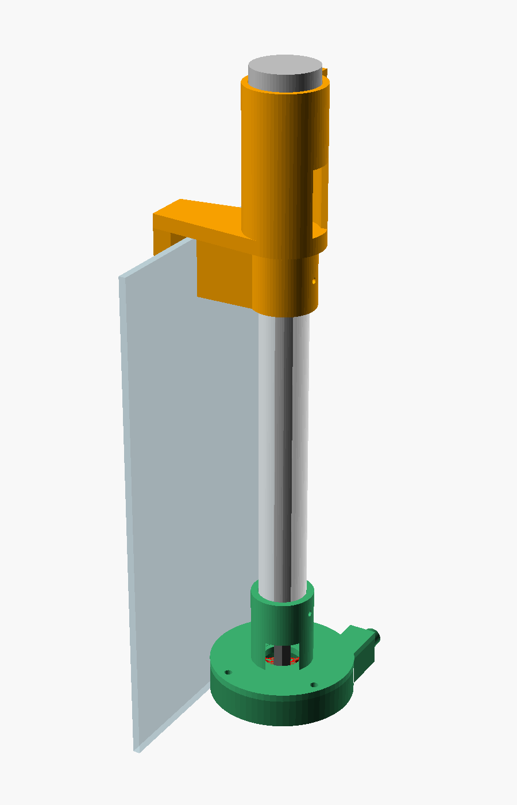
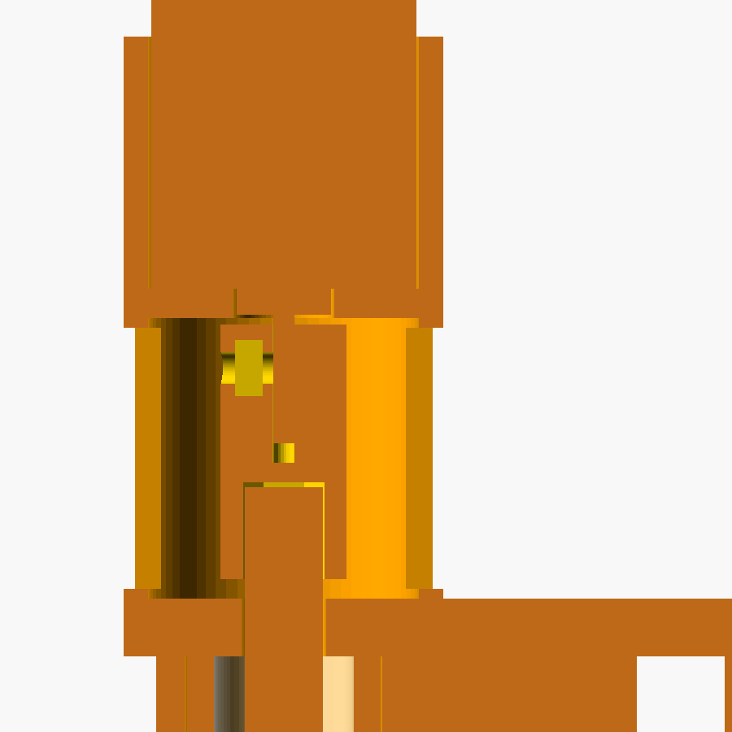
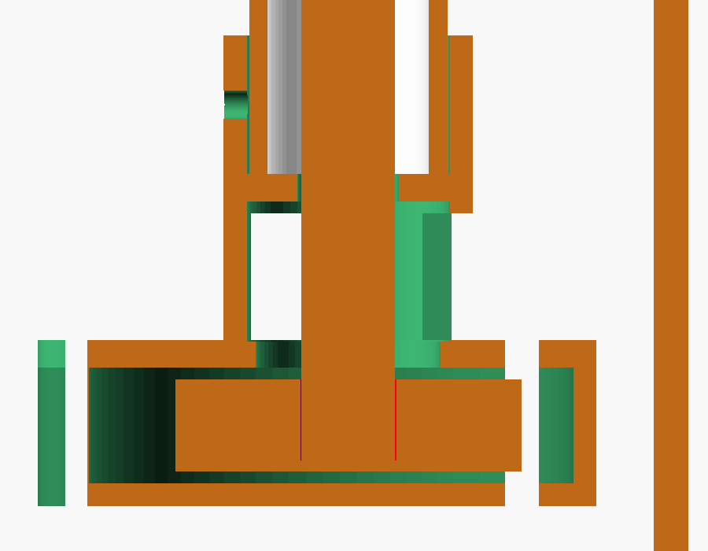

# Bomba d'água de eixo longo (impressão 3D)

Bomba centrífuga para a irrigação. O **motor fica seco**, preso na borda do recipiente por uma garra. Um **eixo sextavado impresso** leva o giro até o **rotor submerso**. A água entra por cima da bomba, em volta do eixo, e sai pelo bico lateral para a mangueira.



| Corte do topo (motor, acoplamento e garra) | Corte da bomba (rotor, voluta e entrada) |
|---|---|
|  |  |

## Ajustar as medidas

Tudo fica em `bomba.scad`, na seção **PARÂMETROS**. Abra no OpenSCAD, que é gratuito, mude os números e exporte de novo. A janela *Customizer* também mostra os campos.

| Parâmetro | Padrão | O que é |
|---|---|---|
| `motor_d` / `motor_chato` | 27.39 / 27.39 | Diâmetro do corpo e distância entre os lados chatos. Motor redondo: mesmo valor nos dois. |
| `motor_comp` | 32.64 | Comprimento do corpo (sem eixo e sem ressalto) |
| `motor_ressalto_d` / `motor_ressalto_h` | 9.71 / 2.64 | Ressalto ("base do eixo") na frente do motor |
| `motor_eixo_d` / `motor_eixo_comp` | 2.18 / 13.30 | Diâmetro e comprimento do eixo do motor |
| `borda_max` | 12 | Espessura máxima de parede que a garra aceita |
| `profundidade` | 200 | Distância do topo da borda até o fundo da bomba |
| `mangueira_de` / `mangueira_di` | 3.85 / 3.20 | Diâmetro externo e interno do tubinho de saída |
| `altura_max` | 200 | Peças mais longas que isso (eixo e tubo) são divididas automaticamente |

> Os valores padrão já são do motor de 12 V e 7000 rpm medido no laboratório (corpo redondo de 27,4 mm).

Para exportar pela linha de comando:
```
openscad -D 'peca="rotor"' -o stl/rotor.stl bomba.scad
```
No console, o OpenSCAD mostra quantos pedaços de eixo e de tubo imprimir.

## Peças (`stl/`, para profundidade = 200)

| Peça | Qtd | Como imprimir |
|---|---|---|
| `suporte` | 1 | Em pé, do jeito que está. Pode precisar de suporte só embaixo da placa. |
| `acoplamento` | 1 | Em pé |
| `eixo` | 2 | Deitado sobre uma face plana, com **100% de preenchimento** |
| `luva_eixo` | 1 | Em pé. Une os pedaços do eixo. |
| `tubo` | 1 | Em pé |
| `luva_tubo` | 0 | Só se o tubo for dividido |
| `rotor` | 1 | Com a placa para baixo |
| `voluta` | 1 | Com o piso para baixo |
| `tampa` | 1 | Com a tampa para baixo |

**Material:** PETG, que aguenta bem a água. PLA serve para testar. Use 4 perímetros nas peças da bomba e no eixo.

## Ferragens

- 1× parafuso **M4 × 20** + porca: aperta a garra na parede
- 2× **M3 × 25** + porcas: braçadeira do motor
- 1× **M3 × 8** + porca: prende o eixo do motor no acoplamento
- 3× **M3 × 12 a 14** + porcas: fecham a bomba (voluta + tampa)
- 2× parafusos autoatarraxantes de **3 mm** (opcional): travam o tubo no suporte e na tampa. Cola também resolve.
- Cola **epóxi** ou **superbonder**: rotor no eixo, emenda do eixo e acoplamento no eixo sextavado

## Montagem

1. Encaixe a porca M3 na fenda lateral do **acoplamento**. Coloque o acoplamento no eixo do motor e aperte o parafuso.
2. Coloque o motor no **berço do suporte**, com o eixo para baixo, e aperte os 2 parafusos M3 da braçadeira.
3. Una os pedaços do **eixo** com a **luva_eixo**, usando cola.
4. Encaixe o **tubo** no suporte por baixo. Passe o eixo por dentro do tubo e pelo furo da placa até ele entrar no sextavado do acoplamento. Cole o eixo no acoplamento.
5. Passe a ponta de baixo do eixo pela **tampa**: primeiro pelo encaixe do tubo, depois pelo mancal e pelo furo de entrada. Encaixe o tubo na tampa.
6. Cole o **rotor** na ponta do eixo, com as pás viradas para cima.
7. Coloque as porcas M3 nos encaixes embaixo da **voluta** e feche com os 3 parafusos.
8. Prenda a garra na borda. A perna de dentro encosta na parede, e o parafuso M4 de fora aperta.
9. Enfie o **tubinho** no furo do bico (entra 8 mm) e cole com epóxi ou superbonder.

## Dicas

- **Sentido de giro:** o rotor tem pás retas, então a bomba funciona nos dois sentidos. Rende mais quando o rotor gira no **sentido anti-horário visto de cima**. Se sair pouca água, inverta os fios do motor.
- **A bomba tem que estar submersa.** Bomba centrífuga não "puxa" água do seco.
- Furos pequenos impressos saem apertados. Se o eixo do motor (2 mm) não entrar no acoplamento, passe uma broca de 2 mm.
- O eixo precisa girar livre nos mancais. Se agarrar, passe uma lixa fina no eixo ou aumente `bucha_d` no código.
